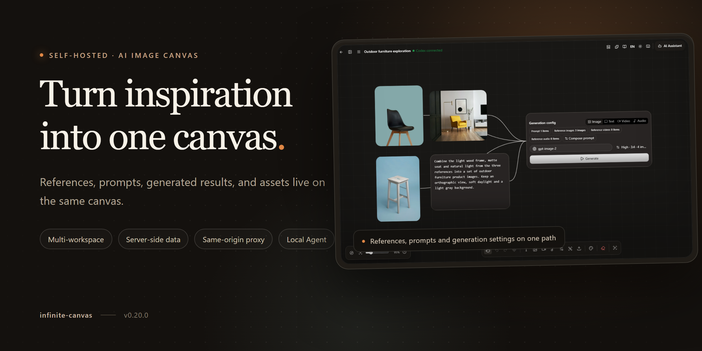
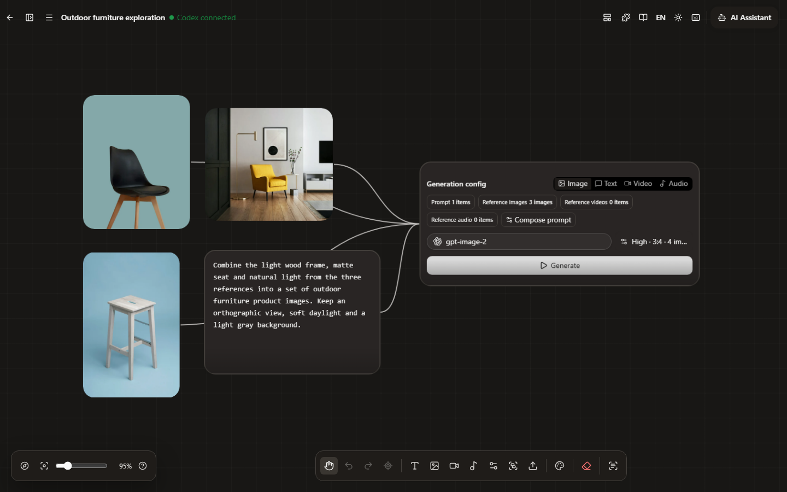

<p align="center">
  <strong>English</strong> | <a href="README.zh-CN.md">简体中文</a>
</p>

<p align="center">
  
</p>

<h1 align="center">Infinite Canvas</h1>

<p align="center"><strong>An AI image workspace you can host yourself</strong></p>

<p align="center">Canvas, generation, assets, prompts and Agent share one workspace.</p>

<p align="center">
  <a href="https://github.com/Ubanillx/infinite-canvas"></a>
  <a href="LICENSE"></a>
  
  <a href="https://vite.dev/"></a>
  <a href="https://reactrouter.com/"></a>
  <a href="https://www.typescriptlang.org/"></a>
</p>

<p align="center">
  <a href="docs/content/docs/overview/quick-start.mdx">Quick start</a> ·
  <a href="docs/content/docs/overview/features.mdx">Features</a> ·
  <a href="docs/content/docs/overview/docker.mdx">Docker</a> ·
  <a href="docs/content/docs/overview/jenkins.mdx">Deployment</a> ·
  <a href="docs/content/docs/canvas/canvas-node-manual.mdx">Canvas manual</a> ·
  <a href="docs/content/docs/overview/codex-app-plugin.mdx">Codex App plugin</a> ·
  <a href="SECURITY.md">Security</a>
</p>

<p align="center">
  
</p>

## One canvas from reference to final image

Infinite Canvas keeps the material for a visual exploration on one canvas. References, prompts, generation settings and results are all nodes; the asset library and the canvas share the same material. Connect them and the canvas becomes a traceable creative trail.

- **Canvas**: multiple projects, folders, templates, node connections, a minimap, undo/redo, marquee selection, import and export.
- **Image and video**: text-to-image, reference-based editing, cropping and multi-angle transforms; results return to the canvas as image, video or audio nodes.
- **AI Assistant**: ask questions or generate images around the selected node and its upstream nodes; results go straight back to the canvas.
- **Local Agent**: Canvas Agent connects Codex or Pi through MCP to read and write the current canvas; the browser only talks to a same-origin gateway and never holds an Agent token.
- **Prompts and assets**: prompt sources are fetched server-side; assets are stored per workspace and can move between nodes and the library.
- **Plugins and Skills**: remote node plugins, the TypeScript SDK, the Codex App plugin and Agent Skills extend node types and Agent capabilities.

<p align="center">
  
</p>

<p align="center"><sub>References, prompts and generation settings on one path.</sub></p>

## How it works

1. **Collect references.** Drag images, video or audio onto the canvas, or pick them from My Assets. They become generation inputs.
2. **Write the prompt.** Use a text node, pull an entry from the prompt library, or type `@` to reference connected media in the composer.
3. **Configure generation.** The generation node collects upstream text and media. Choose the model, aspect ratio, count and quality, then generate in batches.
4. **Review results.** Batch results arrive as a group node. Expand it, set the primary image, retry failures, download, or keep editing.
5. **Keep what works.** Save results to My Assets or save the node prompt to the prompt library for the next canvas.

## Beyond the canvas

- **Image Studio**: start from a prompt and reference images, then keep the generation history and result gallery.
- **Video Studio**: text-to-video and image-to-video with references and common video settings.
- **Prompt library**: custom standard JSON sources, fetched by the server and cached in the browser.
- **My Assets**: images, text and video stored per workspace; search, filter and insert them into the canvas.
- **Templates**: save a canvas as a template, create a new canvas from it, or insert it into the current canvas.
- **Admin and accounts**: user and workspace overview, administrator grants, unified login and per-account generation preferences.

## Who it's for

- Creators who iterate on the same visual direction.
- Product and e-commerce teams building a reusable reference library.
- Teams that want to keep AI creation on their own infrastructure.

## Architecture

- **Browser → app server**: same-origin `/api/*` only, covering auth, workspace data, media, the AI proxy, WebDAV and the Agent gateway.
- **App server → data**: PostgreSQL stores accounts, workspaces and the data index; RustFS or any S3-compatible store keeps media objects.
- **App server → AI providers**: OpenAI-compatible image, text and audio endpoints, plus OpenAI, Gemini, Seedance and custom video protocols. Base URL, API key and model are injected on the server.
- **App server → Canvas Agent**: the Agent listens on `127.0.0.1:17371`; the browser reaches it through the same-origin gateway and never holds an Agent token.
- **Auth**: verified local accounts, Keycloak OIDC (authorization code + PKCE) and account binding; the first verified account becomes the system administrator.
- **Permissions**: providers, prompt sources, WebDAV and storage settings are admin-only; users get redacted config and can override generation preferences per account.

## Get started

```bash
git clone https://github.com/Ubanillx/infinite-canvas.git
cd infinite-canvas
git switch dev
npm install --global bun@1.3.13
cd web && npm ci --legacy-peer-deps && cd ..
cd canvas-agent && npm ci && cd ..
docker compose -f docker-compose.middleware.yml up -d --wait
npm run dev
```

Open `http://127.0.0.1:3000`. PostgreSQL listens on `5433`, RustFS on `9010` (console `9011`).

### First run

1. The first account becomes the system administrator. Local registration requires SMTP and a verified work email; you can also sign in with Keycloak.
2. Open Settings → Providers and enter an OpenAI-compatible Base URL, API key and model. Credentials stay on the server.
3. Create a canvas or open Image Studio and start generating.

> **Note**: Infinite Canvas includes server-side capabilities. Accounts, workspace data, media and AI credentials live on the server; static hosting only serves the page shell.

## Deploy

| Option | Use it for | Entry |
| --- | --- | --- |
| Local development | Changing code, debugging the frontend | Commands above |
| Docker Compose | One complete local stack | `docker compose -f docker-compose.local.yml up -d --build` |
| Production | HTTPS, SSO, automated releases | [Docker deployment](docs/content/docs/overview/docker.mdx) · [Jenkins deployment](docs/content/docs/overview/jenkins.mdx) |

Put production behind an HTTPS reverse proxy and set an exact `INFINITE_CANVAS_ALLOWED_HOSTS` list. Add Keycloak if you need unified login. Back up both PostgreSQL and the object bucket.

## Data and security

- PostgreSQL stores accounts, workspaces and the data index; RustFS, or any S3-compatible store, keeps media objects.
- AI API keys and SMTP passwords are write-only. They do not appear in the browser, config exports or workspace snapshots.
- WebDAV backups are managed by an administrator on the server: manual or scheduled, restored per workspace. They are not two-way sync and do not include accounts, server configuration or Agent thread history.
- The browser never connects directly to object storage; media reads and writes go through authenticated same-origin endpoints.
- Back up both PostgreSQL and the object bucket. One without the other leaves data and media inconsistent.
- The canvas is desktop-first; touch support is still being improved.
- The project is still in development and does not guarantee historical data compatibility. Fork it if you need a stable branch.

## FAQ

### Can I host only the frontend?

No. The app needs server routes for `/api/*`. A static deployment only loads the page shell, so sign-in, saving and generation fail.

### Where are AI keys stored?

On the server. The browser only learns whether a provider is configured.

### Does WebDAV sync automatically?

No. An administrator backs up all workspaces on the server, manually or on a schedule, and restores per workspace. It is not a two-way sync and excludes accounts, server configuration and Agent thread history.

### Can I use my own gateway or relay?

Yes. Add it as an OpenAI-compatible provider, or write a custom generation script for services with different request shapes. Video also supports OpenAI, Gemini, Seedance and custom protocols.

### Is mobile supported?

The canvas is designed for desktop first. Touch interactions are still being improved.

## Tech stack

The frontend uses React 19, React Router 7, TypeScript, Vite 7, Ant Design 6, Tailwind CSS 4 and Zustand. Bun and Node run the services; PostgreSQL and S3-compatible object storage (RustFS by default) hold the data.

## Documentation

- [Features](docs/content/docs/overview/features.mdx)
- [Canvas node manual](docs/content/docs/canvas/canvas-node-manual.mdx)
- [Keyboard shortcuts](docs/content/docs/canvas/canvas-shortcuts.mdx)
- [Codex App plugin](docs/content/docs/overview/codex-app-plugin.mdx)
- [Local development](docs/content/docs/development/local-development.mdx)
- [Docker deployment](docs/content/docs/overview/docker.mdx)
- [Security policy](SECURITY.md)

## License and attribution

Built on top of [basketikun/infinite-canvas](https://github.com/basketikun/infinite-canvas). Forks and PRs must keep the original author information and frontend branding. Licensed under the [MIT License](LICENSE).
