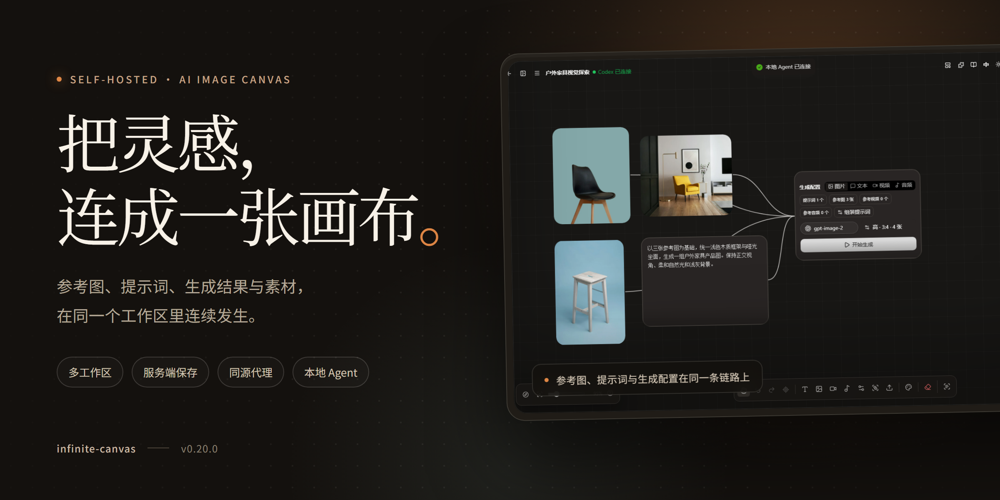
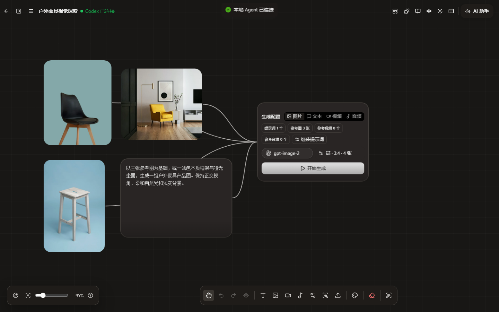

<p align="center">
  <a href="README.md">English</a> | <strong>简体中文</strong>
</p>

<p align="center">
  
</p>

<h1 align="center">无限画布</h1>

<p align="center"><strong>可自托管的 AI 图片创作工作台</strong></p>

<p align="center">画布、生成、素材、提示词和 Agent 都在同一个工作区里。</p>

<p align="center">
  <a href="https://github.com/Ubanillx/infinite-canvas"></a>
  <a href="LICENSE"></a>
  
  <a href="https://vite.dev/"></a>
  <a href="https://reactrouter.com/"></a>
  <a href="https://www.typescriptlang.org/"></a>
</p>

<p align="center">
  <a href="docs/content/docs/overview/quick-start.zh-CN.mdx">快速开始</a> ·
  <a href="docs/content/docs/overview/features.zh-CN.mdx">功能介绍</a> ·
  <a href="docs/content/docs/overview/docker.zh-CN.mdx">Docker 部署</a> ·
  <a href="deploy/README.md">生产部署</a> ·
  <a href="docs/content/docs/canvas/canvas-node-manual.zh-CN.mdx">画布手册</a> ·
  <a href="canvas-agent/README.md">Canvas Agent</a> ·
  <a href="SECURITY.md">安全</a>
</p>

<p align="center">
  
</p>

## 一块画布，装下从参考到成图

无限画布把一次视觉探索需要的材料放在同一张画布上：参考图、提示词、生成配置和结果都是节点，素材库和画布可以互相取用。把它们连起来，就是一条可以追溯的创作链路。

- **无限画布**：多画布项目、文件夹、模板、节点连线、小地图、撤销重做、框选和导入导出。
- **生图与视频**：文生图、参考图编辑、图片裁剪和多角度变换；生成结果会回到画布，成为新的图片、视频或音频节点。
- **画布助手**：围绕选中的节点和上游节点问答、生图，结果直接插回画布。
- **本地 Agent**：Canvas Agent 连接 Codex 或 Pi，通过 MCP 读写当前画布；浏览器只通过同源网关访问，不持有 Agent token。
- **提示词与素材**：提示词来源由服务端拉取；素材按工作区保存，画布节点和素材库可以互相取用。
- **插件与技能**：远程节点插件、TypeScript SDK、Codex App 插件和 Agent 技能，用来扩展画布节点和 Agent 能力。

<p align="center">
  
</p>

<p align="center"><sub>参考图、提示词和生成配置在同一条链路上。</sub></p>

## 它怎么工作

1. **收集参考**：把图片、视频或音频拖进画布，或从「我的素材」取用；它们会作为后续生成的输入。
2. **写提示词**：在文本节点里写，或从提示词库选用；在输入框里用 `@` 引用已经连接的图片、文本、视频和音频。
3. **配置生成**：生成配置节点会汇总上游节点；选择模型、比例、数量和清晰度，然后批量生成图片、文本、视频或音频。
4. **挑选结果**：批量结果先以图片组节点展示；可以展开、设置主图、重试失败项、下载或继续编辑。
5. **沉淀素材**：把满意的结果保存到「我的素材」，或把节点提示词存进提示词库，下一次创作直接复用。

## 画布之外

- **生图工作台**：从提示词和参考图开始，保留每次生成记录和结果画廊。
- **视频工作台**：文生视频、图生视频，支持参考图和常见视频参数。
- **提示词库**：自定义标准 JSON 来源，由服务端拉取，浏览器保留缓存。
- **我的素材**：图片、文本和视频按工作区保存，支持搜索、筛选和插入画布。
- **模板库**：把画布保存为模板，从模板新建，或把模板插入当前画布。
- **管理与账号**：用户与工作区总览、管理员授权、统一登录和按账户覆盖的生成偏好。

## 适合谁

- 需要连续迭代同一组视觉方案的图片创作者。
- 要沉淀商品图、海报或参考素材的产品与电商团队。
- 希望把 AI 创作能力放在自己服务器上的团队。

## 架构

- **浏览器 → 应用服务**：只访问同源 `/api/*`，包括认证、画布数据、媒体、AI 代理、WebDAV 和 Agent 网关。
- **应用服务 → 数据层**：PostgreSQL 保存账号、工作区和数据索引；RustFS 或任意 S3 兼容存储保存媒体对象。
- **应用服务 → AI 渠道**：支持 OpenAI 兼容的图片、文本与音频接口，以及 OpenAI、Gemini、Seedance 和自定义视频协议；Base URL、API Key 和模型由服务端注入。
- **应用服务 → Canvas Agent**：Agent 只监听 `127.0.0.1:17371`；浏览器通过同源网关访问，不持有 Agent token。
- **认证**：本地账号需要工作邮箱验证；支持 Keycloak OIDC（授权码 + PKCE）和账户绑定；首个已验证账户成为系统管理员。
- **权限**：渠道、提示词来源、WebDAV 和存储配置仅管理员可读写；普通用户使用脱敏配置，并可按账户覆盖生成偏好。

## 从启动到第一张图

### 本地开发

```bash
git clone https://github.com/Ubanillx/infinite-canvas.git
cd infinite-canvas
git switch dev
npm install --global bun@1.3.13
cd web && npm ci --legacy-peer-deps && cd ..
cd canvas-agent && npm ci && cd ..
docker compose -f docker-compose.middleware.yml up -d --wait
npm run dev
```

访问 `http://127.0.0.1:3000`。中间件默认端口为 PostgreSQL `5433`、RustFS `9010`（控制台 `9011`）。

### 首次使用

1. 第一个账户会成为系统管理员。本地注册需要先配置 SMTP 并验证工作邮箱；也可以直接使用 Keycloak 统一登录。
2. 在「配置 → 渠道」里填写 OpenAI 兼容的 Base URL、API Key 和模型；这些凭据只保存在服务器上。
3. 新建画布，或进入生图工作台开始生成。

> **说明**：应用包含服务端能力。账号、工作区数据、媒体和 AI 渠道凭据都在服务器上，纯静态托管只能打开页面外壳。

## 部署方式

| 方式 | 适用场景 | 入口 |
| --- | --- | --- |
| 本地开发 | 修改代码、调试前端 | 上方命令 |
| Docker Compose | 单机完整运行 | `docker compose -f docker-compose.local.yml up -d --build` |
| 生产部署 | HTTPS、统一登录、自动发布 | [Docker 部署](docs/content/docs/overview/docker.zh-CN.mdx) · [Jenkins 自动部署](docs/content/docs/overview/jenkins.zh-CN.mdx) |

生产环境需要通过 HTTPS 反向代理访问，并设置准确的 `INFINITE_CANVAS_ALLOWED_HOSTS`。需要统一登录时，配置 Keycloak OIDC。备份要同时覆盖 PostgreSQL 和对象存储桶。

## 数据与安全

- PostgreSQL 保存账号、工作区和数据索引；RustFS（或任意 S3 兼容存储）保存媒体对象。
- AI API Key、SMTP 密码等只写不读回，不会出现在浏览器、配置导出或工作区快照里。
- WebDAV 由管理员在服务端备份全部工作区，支持手动或定时备份、按工作区恢复；它不是双向自动同步，也不包含账号、服务器配置和 Agent 线程历史。
- 浏览器不直连对象存储；媒体读写经过带认证的同源接口。
- 备份要同时覆盖 PostgreSQL 和对象存储桶；只备份其中一个会让数据和媒体不一致。
- 画布以桌面端为主，移动端的触控体验还在完善。
- 项目仍在开发阶段，不保证历史数据兼容；如果需要稳定维护，建议自行 fork 后独立开发。

## 常见问题

### 可以只部署前端吗？

不行。应用需要 `/api/*` 服务端路由；纯静态部署只能打开页面外壳，登录、保存和生成都会失败。

### API Key 保存在哪里？

保存在服务器上。浏览器只知道某个渠道是否已经配置。

### WebDAV 会自动双向同步吗？

不会。管理员在服务端备份全部工作区，可以手动或定时执行，并按工作区恢复；它不是双向同步，也不包含账号、服务器配置和 Agent 线程历史。

### 可以接入自己的中转站或网关吗？

可以。把它添加为 OpenAI 兼容渠道，或为请求格式不同的服务写自定义生成脚本。视频还支持 OpenAI、Gemini、Seedance 和自定义协议。

### 支持手机吗？

画布以桌面端为主，触控体验还在完善。

## 技术栈

前端使用 React 19、React Router 7、TypeScript、Vite 7、Ant Design 6、Tailwind CSS 4 和 Zustand；运行时为 Bun 与 Node；数据层为 PostgreSQL 和 S3 兼容对象存储（默认 RustFS）。

## 文档

- [功能介绍](docs/content/docs/overview/features.zh-CN.mdx)
- [画布节点操作手册](docs/content/docs/canvas/canvas-node-manual.zh-CN.mdx)
- [画布快捷键](docs/content/docs/canvas/canvas-shortcuts.zh-CN.mdx)
- [Codex App 插件](docs/content/docs/overview/codex-app-plugin.zh-CN.mdx)
- [本地开发](docs/content/docs/development/local-development.zh-CN.mdx)
- [Docker 部署](docs/content/docs/overview/docker.zh-CN.mdx)
- [安全策略](SECURITY.md)

## 致谢与许可

本项目基于 [basketikun/infinite-canvas](https://github.com/basketikun/infinite-canvas) 继续开发。二次开发与 PR 请保留原作者信息和前端页面标识。使用 [MIT License](LICENSE)。
